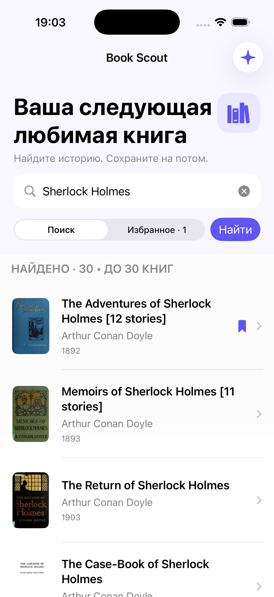

# Book Scout

Небольшое iOS-приложение для поиска книг и собственной полки избранного. SwiftUI, Swift Concurrency, Open Library, локальное JSON-хранилище. Интерфейс на русском, названия и авторы — на языке каталога.



## Что умеет

- Поиск по названию или автору через публичный Open Library Search API, без ключа.
- До 30 произведений за запрос: обложка, название, авторы и год первой публикации.
- Экран книги со ссылкой на Open Library и добавлением в избранное.
- Избранное сохраняется между запусками; его текстовые данные доступны офлайн.
- Состояния ожидания, пустого результата, сетевой ошибки и повторный запрос.
- Отмена прежнего поиска и проверка поколения запроса: поздний ответ не подменит новый запрос.
- Атомарная запись избранного. Ошибка записи не изменяет список в памяти. Повреждённый файл не перезаписывается молча.

Поиск запускается кнопкой «Найти» или клавишей поиска. Ввод текста сам по себе не создаёт сетевых запросов. Между запросами выдерживается минимум одна секунда. Автоматических повторов нет.

## Запуск

1. Откройте `BookScout.xcodeproj` в Xcode 16 или новее (Swift 6).
2. Выберите схему **BookScout** и симулятор с iOS 17 или новее.
3. Нажмите Run. Для запуска на личном iPhone выберите свою команду в Signing & Capabilities и уникальный Bundle Identifier.
4. Введите название, например `Sherlock Holmes`, и нажмите «Найти».

Зависимостей, токенов и настроек сервера нет. Интернет нужен для поиска и загрузки обложек. Запросы отправляются в Open Library по HTTPS; избранное хранится только на устройстве. Аналитики и учётных записей нет.

## Структура

| Файл | Ответственность |
| --- | --- |
| `Book.swift` | Модель книги, преобразование ответа API, устранение повторных произведений |
| `BookService.swift` | Протокол поиска, URLSession, URL-параметры, проверка HTTP-ответа и декодирование |
| `LibraryModel.swift` | Состояния поиска на MainActor, отмена и защита от гонок, избранное и JSON-хранилище |
| `BookScoutApp.swift` | Главный экран, список, детали, обложки и доступность интерфейса |
| `Tests/BookScoutCoreTests/BookScoutTests.swift` | Автоматические проверки без настоящей сети |

В приложении нет отдельного сервера. Модель зависит от протоколов поиска и хранилища, поэтому тесты подставляют управляемые ответы и ошибки. Swift Package использует те же исходники ядра, что и iOS-target; дубликатов реализации нет.

## Проверки

Автоматические проверки повторены 11 ноября 2026 года:

- **9 автоматических тестов Swift Testing прошли, 0 ошибок**: опциональные поля JSON и дубликаты; запись/чтение/повреждение файла; избранное и откат при ошибке; защита повреждённого хранилища; успешный, пустой и пустой текстовый запрос; отображение ошибки; устаревший ответ даже при игнорировании отмены; HTTP-адаптер через URLProtocol (успех, HTTP 503, некорректный JSON, параметры запроса); успешный повтор после ошибки.
- Тесты не отправляют запросы в Open Library и не требуют симулятора.
- **Сборка и запуск через Xcode 26.6 проверены 10 ноября** на iPhone 17 Pro с iOS 26.2. Проверены реальный поиск `Sherlock Holmes` (30 результатов), открытие карточки, добавление в избранное и сохранение книги после перезапуска.
- `screenshot.png` — настоящий снимок работающего приложения на этом симуляторе.
- Повторная сборка из ограниченной командной среды 11 ноября остановилась на запуске макроса Observation (`sandbox-exec: Operation not permitted`). Это отдельное ограничение командной среды; оно не отменяет подтверждённую сборку и работу через Xcode.

Запуск тестов на Mac:

```sh
swift test
```

В ограниченной среде проверка выполнена с временными каталогами кэша и сборки:

```sh
CLANG_MODULE_CACHE_PATH=/private/tmp/bookscout-clang \
SWIFTPM_MODULECACHE_OVERRIDE=/private/tmp/bookscout-clang \
swift test --scratch-path /private/tmp/bookscout-build --disable-sandbox
```

Флаг `--disable-sandbox` относится к собственному запуску манифеста SwiftPM; системные ограничения доступа он не снимает. Логи проверки лежат в `Validation/`.

## Источники и ограничения

- [Официальный Search API](https://openlibrary.org/dev/docs/api/search).
- [Официальный Covers API](https://openlibrary.org/dev/docs/api/covers).
- [Правила использования API](https://openlibrary.org/developers/api).

Результаты относятся к произведениям, а не конкретным изданиям. Русский интерфейс не гарантирует русскоязычные результаты. Нет пагинации, полного текста, аннотаций, синхронизации между устройствами и гарантированного офлайн-кэша обложек. При отсутствии обложки показывается нейтральная иконка. Доступность и полнота данных зависят от Open Library. Обложки принадлежат соответствующим правообладателям; приложение их не включает в исходники.

## Дополнительные сценарии ручной проверки

Проверенные основные сценарии перечислены выше. Следующие проверки не заявляются выполненными:

- Открытие внешней ссылки на правильное произведение.
- Удаление из избранного через интерфейс.
- Пустой результат, отключённая сеть, повтор после восстановления связи.
- Изменение запроса во время загрузки и повторный поиск.
- Большой размер шрифта, VoiceOver, светлая и тёмная темы.

